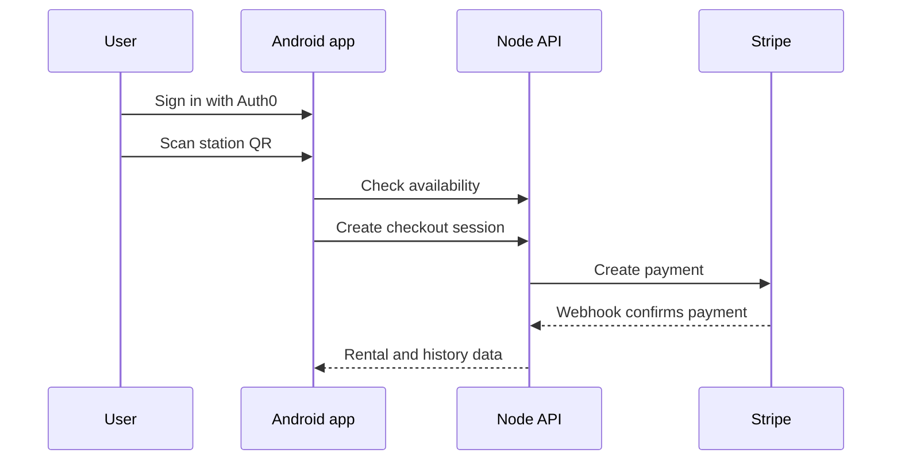

# PowerToGo — Power Bank Rental App

> An Android client for finding, renting, paying for, and returning shared power banks through QR-coded stations.


## Overview

PowerToGo demonstrates the client side of a shared power-bank service. Users authenticate with Auth0, scan a station QR code, check stock, complete Stripe Checkout, review payment history, inspect active rentals, and return their power banks. An admin screen supports user moderation.



## Features

- Auth0 login, logout, roles, and ban checks;
- QR scanning with ZXing/JourneyApps;
- station availability requests through Volley;
- Stripe-hosted payment flow;
- active power-bank and payment-history screens;
- profile and navigation drawer;
- administrator user list with ban/unban actions;
- RecyclerView-based lists and View Binding.

## Requirements

- Android Studio and JDK 17;
- Android SDK 34, minimum Android 7.0 (API 24);
- Auth0 application values in `app/src/main/res/values/auth0.xml`;
- a running companion API from the `stripe-server` repository;
- a reachable API base URL configured in the Kotlin activities.

## Run

```bash
# Windows
gradlew.bat assembleDebug

# macOS/Linux
./gradlew assembleDebug
```

Open the repository in Android Studio for emulator or device deployment.

## Project structure

| Area | Responsibility |
|---|---|
| `LoginActivity` | Auth0 authentication and role routing |
| `MainActivity` | QR scan and station availability |
| `PaymentActivity` | checkout launch |
| `MyPowerBanksActivity` | active rentals and returns |
| `PaymentHistoryActivity` | transaction history |
| `AdminActivity` | user moderation |

## Configuration note

The current code uses a development-machine IP address for the backend. Move the base URL to `BuildConfig` or a resource value before distributing the application.
